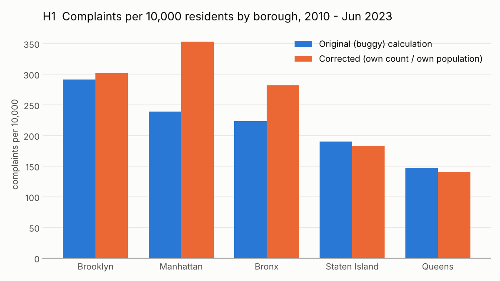
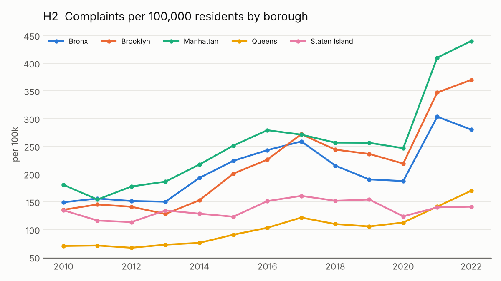
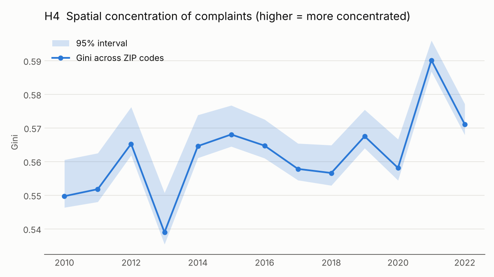

# Are NYC's rats really getting worse? A re-analysis of 311 rat-sighting complaints

**IS597PR Final Project · Type I: critique and improvement of a published analysis**
Author: *[Your Name]* · Status: **Draft stage** (Nov 2026)

This project re-examines
[*New York City Rats Health Problem*](https://github.com/federicodt/nyc-rat-health-problem)
by Federico D.T. (2023). That analysis used NYC Open Data 311 complaints
from 2010 to June 2023 and concluded that:

1. the rat problem is **"getting worse year after year"**,
2. complaints used to be concentrated but are **"now more homogeneous"**, meaning rats have spread, and
3. adjusted for population, **Brooklyn** has the most complaints.

It asks a good question, but the original has calculation errors, makes claims without
statistical tests, and its notebooks can't be re-run. This repository rebuilds
the analysis as a tested, configurable Python package and re-tests each claim.

The full list of problems, with notebook cell references, is in
[`docs/critique.md`](docs/critique.md).

## Key findings so far

All numbers come from the same data snapshot the original used (220,517
complaints, 1 Jan 2010 to 25 Jun 2023). Trend tests use only the complete
years 2010–2022.

| | Original claim | Hypothesis tested here | Result |
|---|---|---|---|
| **H1** | Brooklyn has the highest per-capita complaint rate | Fixing the per-capita calculation changes the ranking | **Supported.** The original divided Manhattan's population into the *Bronx's* complaint count and mixed 2010 and 2020 census figures. Corrected: **Manhattan 353 > Brooklyn 302 > Bronx 282** > Staten Island 184 > Queens 141 per 10,000 residents. |
| **H2** | Worse "year after year" | Complaints rise per capita, even after removing repeat complaints | **Partly supported.** There is a significant upward trend (+13.7 per 100k residents per year, 95% CI 7.0–17.3; Mann-Kendall p < 0.001), and it holds after removing repeat complaints. But the rise wasn't steady: the rate went up in only 8 of 12 year-to-year steps and fell from 2017 to 2020. 2021 and 2022 sit above the 2010–2019 trend band. |
| **H3** | Monthly averages show summer peak | The original monthly averages are biased | **Supported.** Dividing all-time totals by 12 overstates Jan–Jun by ~22% and Jul–Dec by ~8%. The peak month moves from **June to July** once corrected. |
| **H4** | Rats have "spread", complaints are "more homogeneous" | Spatial concentration across ZIP codes decreased | **Not supported (the evidence points the other way).** The Gini coefficient across ~180 ZIP codes rose slightly, from 0.550 (2010) to 0.571 (2022), with a small positive trend (95% CI above 0). |
| **H5** | (implicit) each complaint = a separate event | Repeat complaints at the same address inflate counts | **Supported.** 18.8% of complaints repeat one at the same address within 30 days (10.8% at 7 days, 26.3% at 90). The top "hotspot" address drops from 308 complaints to 41 episodes. |

Data provenance: the original's third source, "Rats Heat Map", contains
**exactly the same 220,517 records** as "Rat Sightings". It is a copy, not an
independent dataset.





More figures and every table: [`outputs/summary.md`](outputs/summary.md) and `outputs/tables/`.

### What this does and does not show

311 complaints measure **how often people report rats**, not how many rats there
are. A higher complaint rate could come from more rats, but also from greater
awareness, 311 app adoption, media coverage, or changes in who lives where. This
project fixes the errors in how complaints were counted and adds proper tests.
It does not claim to measure the rat population. Pairing complaints with
inspection outcomes (see roadmap) is the next step toward that.

## How to run

```bash
pip install -r requirements.txt
# put Rat_Sightings.csv in data/raw/  (see data/README.md)
python -m ratsight.run --config config.yaml      # runs H1-H5, writes outputs/
pytest --cov=src/ratsight                        # tests + doctests
```

(If `python -m ratsight.run` cannot find the package, run
`PYTHONPATH=src python -m ratsight.run`, or `pip install -e .` once a
`pyproject.toml` is added.)

Every experiment and parameter is set in [`config.yaml`](config.yaml): years,
rate denominators, repeat-complaint windows, the baseline period, the spatial
unit, bootstrap size and random seed. To run a new scenario, edit the config.
No code changes are needed.

## Repository layout

```
config.yaml              experiment settings (all hypotheses)
src/ratsight/
  load.py                read only needed columns, clean boroughs/ZIPs/dates, population
  original.py            faithful reproduction of the original's (buggy) calculations
  metrics.py             corrected rates, monthly profile, repeat detection, Gini
  stats.py               Theil-Sen + Mann-Kendall trend test, baseline break, bootstrap
  experiments.py         H1-H5, one function each
  plots.py               figures
  run.py                 CLI runner -> outputs/
tests/                   pytest suite (synthetic data with known answers)
docs/critique.md         detailed critique of the original
data/                    population anchors + instructions for raw data
scripts/download_data.py fetch the latest export from NYC Open Data
outputs/                 example results from the June-2023 snapshot
```

## Improvements over the original code

- One reproducible pipeline instead of five notebooks with hidden state (one
  original cell uses a variable defined in a later cell).
- No hard-coded numbers or Windows-only paths. Everything is computed from data
  and config.
- Reads 11 of 38 columns, so the 95 MB file loads in seconds.
- Type annotations and docstrings on every function. 45 pytest tests and
  doctests, including one that reproduces the original's published per-capita
  numbers exactly, to prove the bug.
- Test coverage: about 95% of lines in `src/ratsight` (measured with Python's
  built-in tracer; confirm with `pytest --cov`).

## Roadmap to final submission (Dec 17)

- [ ] Add NYC **Rodent Inspection** data (DOHMH): compare complaint rates with
      inspection "Rat Activity" rates, and correct the original's lumping of
      "Bait applied"/"Monitoring visit" into "Failed" (critique B7).
- [ ] Extend to data after June 2023 with `scripts/download_data.py`, and test
      whether the 2021–22 jump persists.
- [ ] Normalize by total 311 volume to separate rat complaints from general
      growth in 311 use.
- [ ] Use annual population estimates (not just interpolation between censuses) as a sensitivity check.
- [ ] Add `pyproject.toml` and GitHub Actions CI.

## Sources

- Original analysis: Federico D.T. (2023). *New York City Rats Health Problem.*
  <https://github.com/federicodt/nyc-rat-health-problem>. The functions in
  `src/ratsight/original.py` re-implement its calculations to demonstrate the
  errors. No other code was copied.
- NYC Open Data. *Rat Sightings* (311 Service Requests), dataset 3q43-55fe.
  <https://data.cityofnewyork.us/Social-Services/Rat-Sightings/3q43-55fe>
- U.S. Census Bureau via NYC Department of City Planning: 2010 Census table PL-P5,
  <https://www.nyc.gov/assets/planning/download/pdf/data-maps/nyc-population/census2010/t_pl_p5_nyc.pdf>;
  2020 Census redistricting data,
  <https://www.nyc.gov/assets/districting/downloads/pdf/dcp-presentation-5-11-22.pdf>
- Methods: Sen, P. K. (1968). Estimates of the regression coefficient based on
  Kendall's tau. *JASA* 63(324). Mann, H. B. (1945). Nonparametric tests against
  trend. *Econometrica* 13(3). Implemented with `scipy.stats.theilslopes` and
  `scipy.stats.kendalltau`.
- Chart palette: a colorblind-checked categorical order (blue, orange, aqua,
  yellow, magenta).
- Generative AI: parts of the code and documentation were drafted with help from
  Claude (Anthropic) and then reviewed, run and edited by the author.
