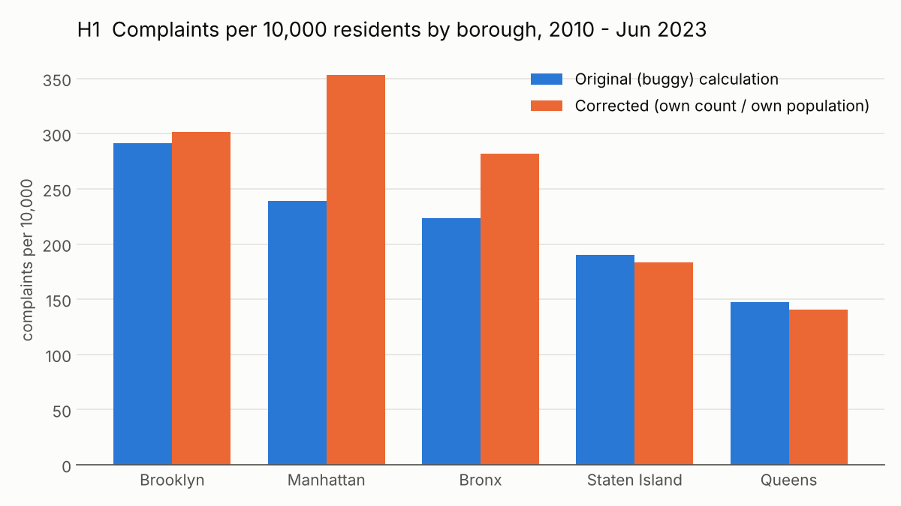
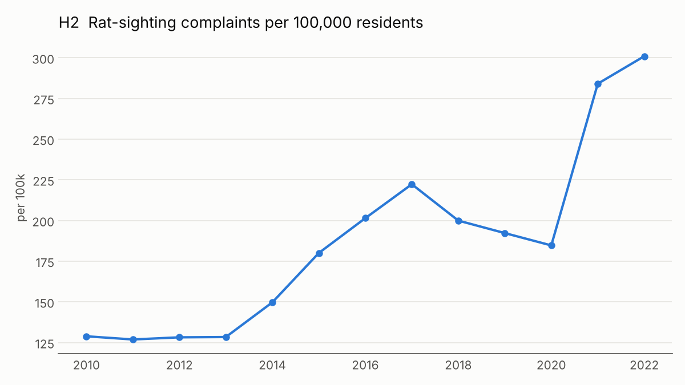
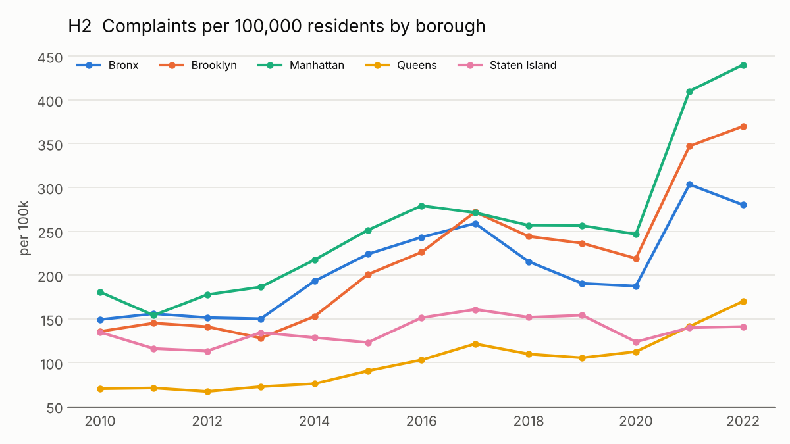
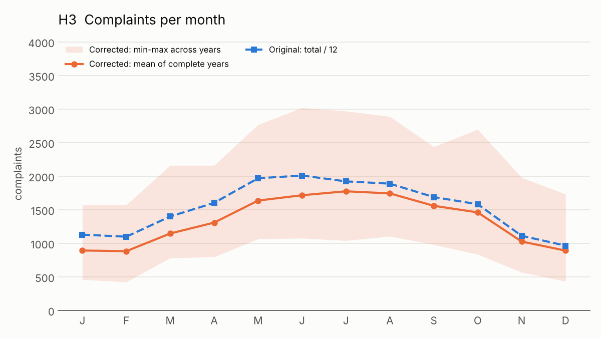
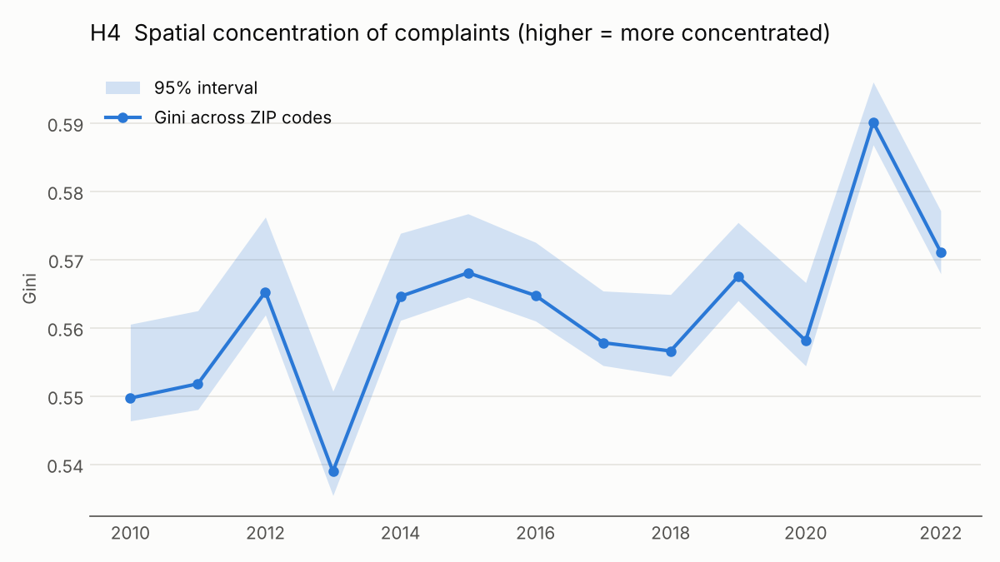

# Results summary

Generated by `python -m ratsight.run`.

- Records loaded: 220,517
- Date range: 2010-01-01 to 2023-06-25
- Complete years analysed: 2010-2022
- 'Rats Heat Map' export has identical records to 'Rat Sightings': True

## H1: Fixing the per-capita bug changes the borough ranking

SUPPORTED: ranking changes for Brooklyn, Manhattan. Corrected order: Manhattan > Brooklyn > Bronx > Staten Island > Queens.

## H2: Complaints rise year after year (per capita, repeats removed)

PARTLY SUPPORTED: upward trend per capita (Theil-Sen 13.7/100k/yr, 95% CI 7.0 to 17.3, Kendall p=0.001), but it is NOT 'year after year': the rate rose in only 8 of 12 year-to-year steps. Years above the 2010-2019 trend band: [2021, 2022].

## H3: Original monthly averages are biased

SUPPORTED: original method overstates Jan-Jun by 22% on average vs 8% for Jul-Dec. Peak month: original 6, corrected 7.

## H4: Complaints became more spread out over time

NOT SUPPORTED: Gini across Incident Zip went from 0.550 (2010) to 0.571 (2022); trend is increasing (more concentrated) (slope 0.0012/yr, 95% CI 0.0001 to 0.0037).

## H5: Repeat complaints inflate counts

SUPPORTED: 18.8% of complaints repeat a complaint at the same address within 30 days; top 'hotspot' addresses shrink sharply when counted as episodes.

